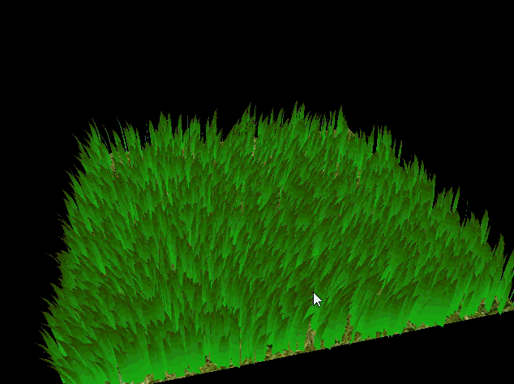
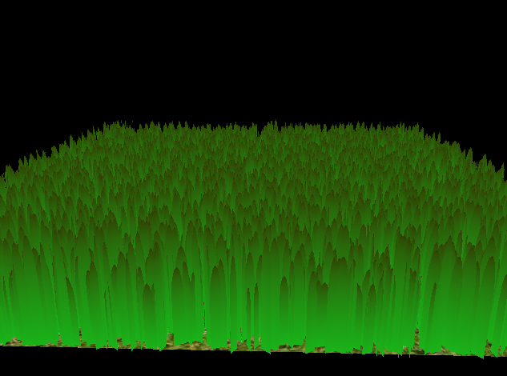
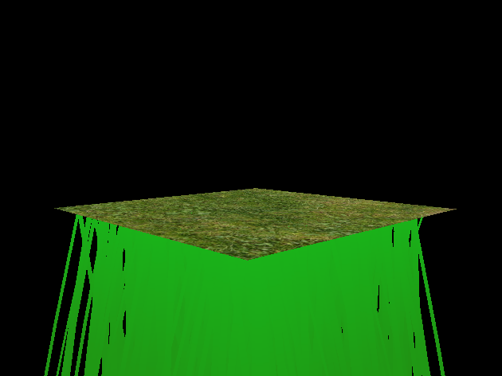
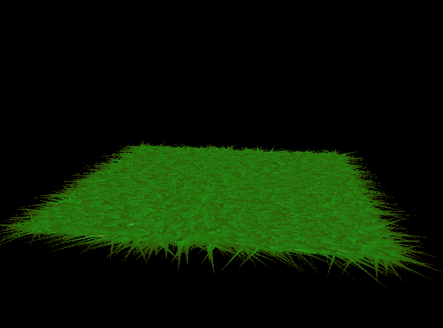
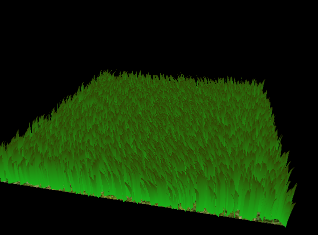
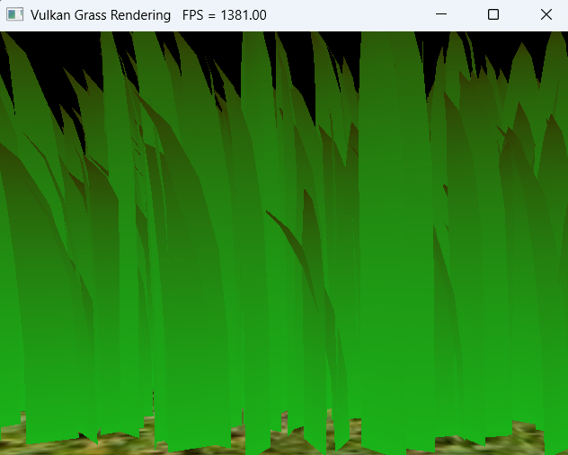
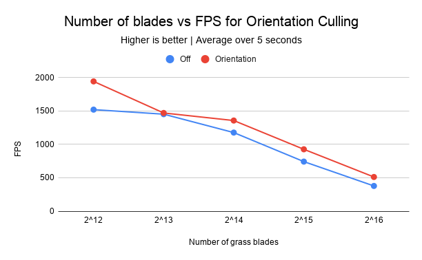
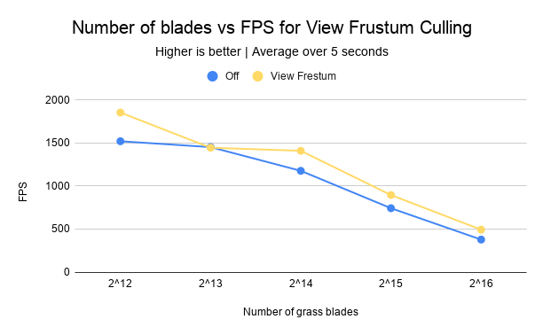
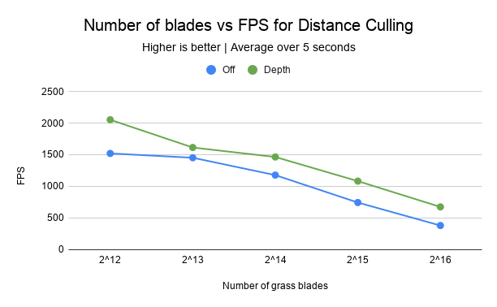
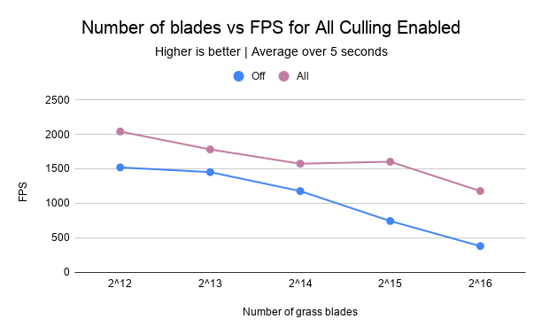

Vulkan Grass Rendering
==================================

**University of Pennsylvania, CIS 565: GPU Programming and Architecture, Project 5**

* Walson Li
* Tested on: Windows 11 Home, i5-10300H @ 2.50GHz, RTX 2060 6GB (Personal Laptop)

## Grass in Vulkan

## Overview

This is an implementation of grass based off of the paper [Responsive Real-Time Grass Rendering for General 3D Scenes](https://www.cg.tuwien.ac.at/research/publications/2017/JAHRMANN-2017-RRTG/JAHRMANN-2017-RRTG-draft.pdf).

This project involved setting up the descriptor sets to connect grass buffers to shaders in Vulkan. It also required completing the vertex, tessellation control, tessellation evaluation, and fragment shaders. The tessellation control shader sets how finely each blade is subdivided, and the tessellation evaluation shader places each generated vertex along the blade’s Bezier curve to form its shape. I also implemented the compute shader that applies forces and culling to the grass.

To run locally I had to add CMAKE_VERSION VERSION_LESS "4.0" into the GLFW CMakeLists, and configure with -DCMAKE_POLICY_VERSION_MINIMUM=3.5.

## Features

#### Blade geometry calculation:

The blade vertices are calculated using Bezier curves with three control points to help simulate bending. Each blade is then tessellated into 5 vertical blocks, and the τ I chose makes the grass get smaller halfway up the height. Setting this up without any of the other visual features gives static grass:

#### Gravity:

This was added to make the grass more realistic. Here is how it looked after implementing gravity, without the state validation to prevent grass from going into the ground:

#### Recovery:

This is how well the grass will bounce back. Including this lets us customize how stiff the grass is. It works together with the wind to make the grass look visually appealing. With no recovery, the grass looks like this:

#### Wind:

This makes the grass more visually appealing. The function I chose was `wind = (3sin(time + x/3), 0, 0)` to simulate variable wind blowing in the x direction. This makes different areas bend in different amounts which makes the scene more dynamic:

### Performance features

For performance, I implemented three different ways of culling to reduce the number of grass blades that need to get rendered. Note that FPS readings are determined from setting VK_LOADER_LAYERS_ENABLE=*monitor in the build properties. All readings are from release mode in the default view:

#### Orientation Culling:

Depending on how you look at it, a blade of grass can be thick or thin. Orientation culling part of the shader gets rid of the blades of grass that the user would see as extremely thin. The idea is that even if it were rendered, it wouldn't add much visual impact, even though it wastes GPU time. Here is a FPS comparison chart of orientation culling on and off with variable number of grass blades:

| # Blades | Off (FPS) | Orientation (FPS) | Off (ms) | Orientation (ms) |
|---|---|---|---|---|
| 2^12 | 1519 | 1941 | 0.66 | 0.52 |
| 2^13 | 1451 | 1469 | 0.69 | 0.68 |
| 2^14 | 1176 | 1356 | 0.85 | 0.74 |
| 2^15 | 742 | 926 | 1.35 | 1.08 |
| 2^16 | 378 | 512 | 2.65 | 1.95 |

Orientation culling on consistently has faster frame times than no culling. This is expected because less grass means less GPU time spent. However, orientation culling still follows generally the same trend as no culling with this test setup. This is because on average, the percent of grass blades that are thin is pretty flat, so we would expect a consistently flat improvement over no culling.

#### View Culling:

This involved culling blades of grass if they are out of the viewport. Here is a FPS comparison chart of view frustum culling on and off with variable number of grass blades:

| # Blades | Off (FPS) | View Frustum (FPS) | Off (ms) | View Frustum (ms) |
|---|---|---|---|---|
| 2^12 | 1519 | 1852 | 0.66 | 0.54 |
| 2^13 | 1451 | 1444 | 0.69 | 0.69 |
| 2^14 | 1176 | 1408 | 0.85 | 0.71 |
| 2^15 | 742 | 895 | 1.35 | 1.12 |
| 2^16 | 378 | 493 | 2.65 | 2.03 |

View culling had a similar trend to orientation culling. This is likely because the view looks at the same percent of grass blades, therefore we would expect a flat improvement over no culling.

#### Distance Culling:

This involved culling grass when it is far away from the camera, like view distance. This involved setting up distance rings around the camera, and the rings that are farther away keep less grass blades. Here is a FPS comparison chart of distance culling on and off with variable number of grass blades:

| # Blades | Off (FPS) | Distance (FPS) | Off (ms) | Distance (ms) |
|---|---|---|---|---|
| 2^12 | 1519 | 2052 | 0.66 | 0.49 |
| 2^13 | 1451 | 1613 | 0.69 | 0.62 |
| 2^14 | 1176 | 1463 | 0.85 | 0.68 |
| 2^15 | 742 | 1081 | 1.35 | 0.93 |
| 2^16 | 378 | 673 | 2.65 | 1.49 |

Distance culling had the largest impact with the default camera position because the largest percentage of grass blades is getting thinned out.

## Performance Analysis

With all three culling features enabled, here is the performance difference compared to no culling with variable number of grass blades:

| # Blades | Off (FPS) | All (FPS) | Off (ms) | All (ms) |
|---|---|---|---|---|
| 2^12 | 1519 | 2040 | 0.66 | 0.49 |
| 2^13 | 1451 | 1780 | 0.69 | 0.56 |
| 2^14 | 1176 | 1573 | 0.85 | 0.64 |
| 2^15 | 742 | 1602 | 1.35 | 0.62 |
| 2^16 | 378 | 1177 | 2.65 | 0.85 |

Turning on all the culling methods gives a significant performance boost over the baseline as well as any of the individual culling methods. This is expected because strategies from the three culling methods mostly remove different blades, so combining them will remove more.

Interestingly, at 2^15 blades of grass the "all" culling was faster than the point at 2^14. This is probably noise, because the fps is expected to decrease with more grass blades.

## References

This project is based off of the paper [Responsive Real-Time Grass Rendering for General 3D Scenes](https://www.cg.tuwien.ac.at/research/publications/2017/JAHRMANN-2017-RRTG/JAHRMANN-2017-RRTG-draft.pdf).